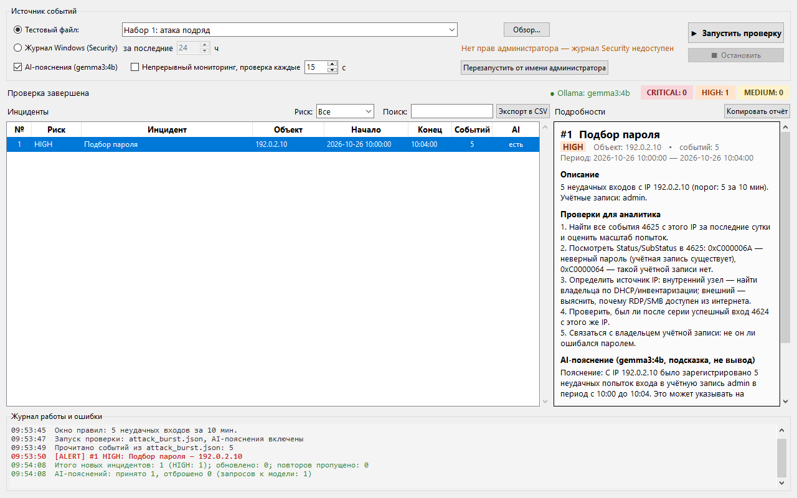
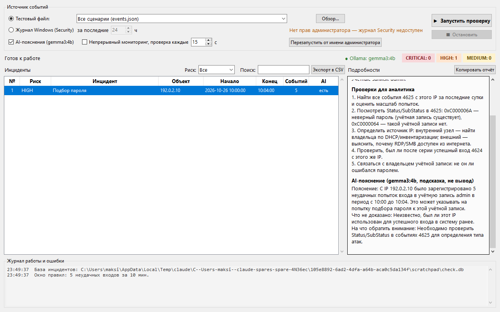

# AI-assisted Security Monitoring System — помощник SOC

Учебный прототип помощника аналитика SOC первой линии. Он читает журнал Windows **Security** (или тестовый JSON), находит подозрительные события по правилам со скользящим временным окном, сохраняет инциденты в SQLite без дублей, выдаёт аналитику готовый список проверок и запрашивает у локальной модели Ollama дополнительное пояснение. Работает в окне (`gui.py`) или в консоли (`main.py`).



## Структура

| Файл | Назначение |
|---|---|
| `gui.py` | Оконный интерфейс |
| `start_gui.bat` | Запуск окна двойным щелчком |
| `main.py` | Консольная версия: параметры запуска, однократная проверка или непрерывный мониторинг |
| `assistant.py` | Ядро помощника, общее для окна и консоли: источники → правила → база → AI |
| `sources.py` | Чтение журнала Windows (pywin32) и тестового JSON, приведение событий к единому формату |
| `rules.py` | Правила обнаружения, их пороги и списки проверок для аналитика |
| `storage.py` | База `incidents.db`: сохранение, защита от дублей, состояние мониторинга |
| `ai.py` | Дополнительное пояснение от Ollama (`gemma3:4b`) и автоматическая проверка его качества |
| `events.json` | Тестовые сценарии |
| `tests/` | Наборы данных из задания и автотесты правила |
| `docs/` | Снимки окна, выводы проверок и ответ модели для отчёта |

## Задание: 5 неудачных входов за 10 минут

Правило «Подбор пароля» срабатывает, если с одного IP было **≥ 5 неудачных входов (4625) за 10 минут** (скользящее окно, `WINDOW` в `rules.py`). Проверка на двух наборах из `tests/`:

| Набор | Данные | Ожидание | Результат |
|---|---|---|---|
| `attack_burst.json` — атака подряд | 5 неудачных входов `admin` с `192.0.2.10`, раз в минуту (10:00–10:04) | инцидент | ✔ 1 инцидент HIGH «Подбор пароля», 5 событий |
| `attack_spread_day.json` — растянуто на день | те же 5 ошибок, раз в 2 часа (09:00–17:00) | нет инцидента | ✔ «Новых подозрительных событий не найдено» |

Автотесты (`tests/test_rules.py`) проверяют оба набора и границу окна: 5 ошибок за 9 мин 56 с и ровно за 10 мин — инцидент, за 10 мин 4 с — нет, 4 ошибки — нет.

```powershell
python -m unittest -v
```

Результат запуска на обоих наборах (1 ноября 2026, с AI-пояснениями):

```text
> python main.py --file tests/attack_burst.json
Прочитано событий из attack_burst.json: 5

[ALERT #1] Риск: HIGH | Подбор пароля
  Период: 2026-10-26 10:00:00 — 10:04:00 | событий: 5
  5 неудачных входов с IP 192.0.2.10 (порог: 5 за 10 мин). Учётные записи: admin.
  ...
Итого новых инцидентов: 1 (HIGH: 1); обновлено: 0; повторов пропущено: 0
AI-пояснений: принято 1, отброшено 0 (запросов к модели: 1)

> python main.py --file tests/attack_spread_day.json
Прочитано событий из attack_spread_day.json: 5
Новых подозрительных событий не найдено.
```

Полные выводы: [`docs/run_attack_burst.txt`](docs/run_attack_burst.txt), [`docs/run_attack_spread_day.txt`](docs/run_attack_spread_day.txt). Снимки окна: [`docs/gui_attack_burst.png`](docs/gui_attack_burst.png), [`docs/gui_attack_spread_day.png`](docs/gui_attack_spread_day.png).

## Пример ответа модели

Реальный ответ `gemma3:4b` на инцидент из набора 1, текст из блока «Подробности» (кнопка «Копировать отчёт»). Ответ получен за 27 с и принят автоматической проверкой с первой попытки. Полный отчёт: [`docs/ai_answer_attack_burst.txt`](docs/ai_answer_attack_burst.txt), снимок: [`docs/gui_ai_answer.png`](docs/gui_ai_answer.png).

```text
AI-пояснение (gemma3:4b, подсказка, не вывод)
Пояснение: С IP 192.0.2.10 было зарегистрировано 5 неудачных попыток входа в учётную запись admin в период с 10:00 до 10:04. Это может указывать на попытку подбора пароля к этой учётной записи.
Что не доказано: Неизвестно, был ли этот IP использован для успешного входа в систему ранее.
На что обратить внимание: Необходимо проверить Status/SubStatus в событиях 4625 для определения типа атак.
```



Оценка ответа. Факты (IP, учётная запись, число попыток, время) переданы верно, формулировки осторожные («может указывать»), выдуманных адресов и кодов нет. Слабое место: поле «На что обратить внимание» по сути повторяет проверку № 2, хотя должно содержать новую деталь. Автоматическая проверка этого не заметила, потому что совпало меньше половины слов. Поэтому пояснение модели — подсказка, а основой для аналитика остаются проверки.

## Оконный интерфейс

Запуск: двойной щелчок по `start_gui.bat` или `python gui.py`.

- **Источник событий** — тестовый файл (в списке есть оба набора из задания и `events.json`, кнопка «Обзор…» для своего файла) или журнал Windows Security за N часов.
- **Права администратора** — окно показывает, есть ли они. Кнопка «Перезапустить от имени администратора» нужна для чтения журнала Security.
- **AI-пояснения** и **непрерывный мониторинг** включаются галочками. «Остановить» прерывает проверку.
- **Таблица инцидентов** — цвет строки по риску, фильтр по риску, поиск, счётчики CRITICAL/HIGH/MEDIUM, состояние Ollama.
- **Подробности** выбранного инцидента — описание, проверки для аналитика, AI-пояснение. Кнопка «Копировать отчёт» копирует всё в буфер, чтобы передать на вторую линию.
- **Экспорт в CSV** — выгрузка таблицы для Excel.
- **Журнал работы и ошибки** — все сообщения с временем: тревоги и ошибки красным, предупреждения оранжевым. Серьёзные ошибки (нет доступа к журналу, файл не найден) дополнительно показываются во всплывающем окне.

Проверка выполняется в отдельном потоке, поэтому окно не «зависает», пока модель готовит пояснение (около 20 с на инцидент).

## Отслеживаемые события Windows

| Event ID | Событие |
|---|---|
| 4625 | Неудачный вход |
| 4624 | Успешный вход (только типы 2, 3, 8, 10 и только с IP-адресом) |
| 4740 | Учётная запись заблокирована |
| 4720 | Создана учётная запись |
| 4732 | Пользователь добавлен в локальную группу |
| 1102 | Журнал аудита очищен |

Служебные входы (тип 5 и подобные) и локальные адреса отбрасываются как шум.

## Правила

| Правило | Условие | Риск |
|---|---|---|
| Подбор пароля | ≥ 5 неудачных входов с одного IP за 10 минут | HIGH |
| Перебор учётных записей | Неудачные входы в ≥ 3 разные учётные записи с одного IP за 10 минут | HIGH |
| Успешный вход после подбора | Успешный вход с IP, с которого за 10 минут до этого было ≥ 5 неудачных | CRITICAL |
| Блокировка учётной записи | 4740 | MEDIUM |
| Создание учётной записи | 4720 | MEDIUM |
| Добавление в группу | 4732; HIGH, если группа Администраторы / Пользователи удалённого рабочего стола | MEDIUM / HIGH |
| Очистка журнала | 1102 | HIGH |

Пороги задаются в начале `rules.py` (`WINDOW`, `BRUTE_FORCE_THRESHOLD`, `SPRAY_USERS_THRESHOLD`).

## Проверки для аналитика и роль AI

Для каждого правила в `rules.py` (словарь `PLAYBOOKS`) задан фиксированный список проверок для первой линии: какие события искать, что уточнить у пользователя, когда эскалировать. Список выводится под каждым инцидентом в блоке «Проверки для аналитика» и сохраняется в колонку `checks`. Он не зависит от модели, поэтому корректные шаги будут и при выключенной Ollama, и при ошибке модели.

AI (Ollama) — **дополнительное пояснение**, а не вывод. Модель отвечает тремя полями: «Пояснение / Что не доказано / На что обратить внимание» и не повторяет проверки.

Как повышается качество ответа (всё в `ai.py`):
1. **Суть правила.** Модели передаётся объяснение атаки простыми словами (`RULE_ABOUT` в `rules.py`), чтобы она не придумывала своё толкование.
2. **Образец ответа.** В запрос включён эталонный ответ на вымышленный инцидент другого типа: модель перенимает стиль и конкретику, но не текст.
3. **Ответ строго по JSON-схеме.** Ollama (`format`) заставляет модель вернуть ровно три заполненных поля.
4. **Автоматическая проверка.** Ищутся иероглифы, посторонние английские слова, IP-адреса и коды событий, которых нет в фактах, категоричные утверждения без оговорок («пароль подобран»), пересказ готовой проверки вместо новой детали и слишком длинный текст.
5. **Повтор и отбраковка.** При ошибках модели один раз отправляется повторный запрос с перечнем ошибок. Если и второй ответ плохой, он не показывается: `[AI] Пояснение отброшено ... Используйте проверки выше.`

### Выбор модели

Все модели бесплатные и работают локально, без интернета и API-ключей. Их сравнили на 7 тестовых инцидентах на компьютере практики (i5-4670, 16 ГБ ОЗУ, GTX 970 4 ГБ):

| Модель | Лицензия | Принято с 1-й попытки | Время на 7 инцидентов | Качество |
|---|---|---|---|---|
| llama3.2:3b | Llama 3.2 Community | 5/7 | 166 с | копирует образец, путает поля, английские слова |
| qwen3:4b | Apache 2.0 | 7/7 | 196 с | фактические ошибки («тип входа 3 = неудачный вход»), ошибки в русском |
| qwen2.5:7b | Apache 2.0 | 7/7 | 237 с | домыслы, ошибается в указанных полях |
| **gemma3:4b** | Gemma Terms of Use | **7/7** | **203 с** | **лучший русский, меньше всего ошибок в фактах** |

Выбрана **gemma3:4b**. Модель задаётся константой `MODEL` в `ai.py`.

Атака из множества событий даёт **один** инцидент. Если она продолжается, существующий инцидент обновляется (`[UPDATE]`), а не дублируется. Повторный запуск на тех же данных новых записей не создаёт.

## Запуск в Windows

### Установка (один раз)

1. Установите Python 3.10 или новее: https://www.python.org/downloads/ (при установке отметьте «Add python.exe to PATH»).
2. Установите Ollama: https://ollama.com/download. После установки она работает в фоне (значок в трее).
3. Откройте PowerShell в этой папке и выполните:

```powershell
py -m venv .venv
.\.venv\Scripts\Activate.ps1
pip install -r requirements.txt
ollama pull gemma3:4b
```

Если активация PowerShell заблокирована, вызывайте `.\.venv\Scripts\python.exe` вместо `python`.

`requirements.txt` ставит `requests` (запросы к Ollama) и `pywin32` (чтение журнала Windows). Модель занимает около 3,3 ГБ.

### Запуск

| Что нужно | Команда | Права |
|---|---|---|
| Окно, тестовые наборы | двойной щелчок по `start_gui.bat` или `python gui.py` | обычные |
| Консоль, тестовые наборы | `python main.py` / `python main.py --file tests\attack_burst.json` | обычные |
| Автотесты правила | `python -m unittest -v` | обычные |
| Журнал Security | `python main.py --source windows` или окно → «Журнал Windows (Security)» | администратор (см. ниже) |

Ollama нужна только для AI-пояснений. Без неё (или с `--no-ai`) правила, база и проверки для аналитика работают полностью.

### Права для чтения журнала Security

Журнал Security защищён сильнее остальных журналов. По умолчанию Windows разрешает читать его только:

- **Администраторам в процессе с повышенными правами.** Даже если ваша учётная запись входит в группу «Администраторы», из-за UAC обычное окно PowerShell запускается без этих прав, и чтение завершится ошибкой «Отказано в доступе» (код 5). Помощник сообщит: «Нет доступа к журналу Security. Запустите PowerShell от имени администратора».
- **Членам группы «Читатели журнала событий» (Event Log Readers)** — без прав администратора, только чтение.
- **Системе** (LOCAL SYSTEM), например службе или задаче планировщика.

Способы запуска с нужными правами (выберите один):

1. **От имени администратора (проще всего).** Пуск → правой кнопкой по «Windows PowerShell» → «Запуск от имени администратора», перейти в папку проекта и выполнить `python main.py --source windows`. В окне — кнопка «Перезапустить от имени администратора», появится запрос UAC.
2. **Без прав администратора — через группу «Читатели журнала событий».** Один раз из PowerShell администратора добавить пользователя в группу, затем **выйти из Windows и войти снова** (членство в группе применяется при входе):

   ```powershell
   Add-LocalGroupMember -SID "S-1-5-32-573" -Member $env:USERNAME
   ```

   После этого журнал читается из обычного PowerShell. Это вариант минимальных прав: помощник только читает журнал и ничего не меняет в системе, поэтому администратор ему не нужен. Проверить, кому открыт доступ, можно из PowerShell администратора: `wevtutil gl Security` → строка `channelAccess`; `S-1-5-32-573` в ней — это «Читатели журнала событий».

Доступ к журналу не даёт событий, если аудит выключен. Чтобы появлялись 4625/4624, включите аудит входа (из PowerShell администратора):

```powershell
auditpol /set /subcategory:"{0CCE9215-69AE-11D9-BED3-505054503030}" /success:enable /failure:enable
auditpol /get /subcategory:"{0CCE9215-69AE-11D9-BED3-505054503030}"
```

(GUID — подкатегория «Вход в систему», он не зависит от языка Windows.) Для 4740, 4720 и 4732 нужен аудит «Управление учётными записями пользователей» / «Управление группами безопасности»; на домашних редакциях Windows он обычно уже включён для успеха.

### Если AI-пояснение не приходит или идёт минутами

Модели нужно около 3,5 ГБ видеопамяти. Если её занимают браузер, мессенджеры и другие программы, Ollama частично переносит модель в общую память, и ответ может не уложиться в 5 минут (`Read timed out`). Проверка: `ollama ps` — в столбце PROCESSOR будет смесь CPU/GPU. Решения:

- закрыть лишние программы, использующие видеокарту;
- или ограничить число слоёв на видеокарте перед запуском:

```powershell
$env:SOC_NUM_GPU = "20"   # для GTX 970 4 ГБ; "0" - только процессор
python main.py
```

На компьютере практики при занятой видеопамяти один ответ без настройки не уложился в 300 с, а с `SOC_NUM_GPU=20` занял 27 с.

### Режимы консольной версии

Окно (`start_gui.bat` / `python gui.py`) умеет всё то же самое. Консоль удобна для скриптов и отладки.

```powershell
python main.py                                   # тестовые сценарии из events.json
python main.py --no-ai                           # то же, без обращения к Ollama
python main.py --source windows                  # журнал Security за последние 24 ч
python main.py --source windows --hours 2        # за последние 2 ч
python main.py --source windows --follow         # непрерывный мониторинг (опрос каждые 15 с)
python main.py --follow                          # следить за изменениями events.json (для демонстрации)
```

Для `--source windows` нужны права на чтение журнала Security — см. раздел «Права для чтения журнала Security» выше.

В режиме `--follow` номер последней прочитанной записи журнала сохраняется в базе. После перезапуска мониторинг продолжится с того же места. Остановка — Ctrl+C.

## Тестовые сценарии (`events.json`)

Адреса взяты из диапазонов, зарезервированных для документации, это не реальные атакующие.

1. `192.0.2.10`: 6 неудачных RDP-входов в `admin`, затем успешный вход → «Подбор пароля» (HIGH) + «Успешный вход после подбора» (CRITICAL).
2. `198.51.100.7`: попытки входа в 4 разные учётные записи → «Перебор учётных записей» (HIGH).
3. `10.0.0.25`: сотрудник дважды ошибся паролем и вошёл → **не инцидент**.
4. `203.0.113.50`: 5 ошибок, растянутых на час → **не инцидент** (не укладываются в окно 10 минут).
5. Блокировка `buh`, создание `support_tmp`, добавление его в Administrators, очистка журнала → по одному инциденту на каждое.

Ожидаемый итог: 7 новых инцидентов (CRITICAL: 1, HIGH: 4, MEDIUM: 2). При повторном запуске выводится «Новых подозрительных событий не найдено».

## База `incidents.db`

Таблица `incidents`: `id, rule, title, severity, entity, ip, username, first_seen, last_seen, event_count, description, checks, ai_analysis, created_at, updated_at`. Таблица `state` хранит позицию в журнале. Старая база MVP обновляется автоматически, прежние записи сохраняются.

## Ограничения

- Программа только уведомляет и ничего не блокирует. Решение принимает аналитик.
- Читается журнал только локального компьютера. Сбор с нескольких узлов (WEF, SIEM) не реализован.
- AI-пояснение — подсказка, а не вывод. Маленькая модель может ошибаться, факты нужно проверять по журналу.
- Не передавайте секреты и реальные производственные журналы без разрешения.

В отчёте указывайте AI-анализ как выполненный, только если в консоли появился ответ в блоке `[Ollama / gemma3:4b]`.
